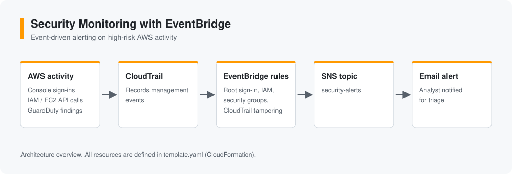

# Security Monitoring with EventBridge

Implemented AWS audit-event monitoring using Amazon EventBridge, explored event-driven threat detection, and configured automated security alerts.



> **Status:** the CloudFormation template is published. Lab notes and alert screenshots are being added.

## Detections

| EventBridge rule | Triggers on | Why it matters |
| --- | --- | --- |
| RootAccountSignInRule | Root user console sign-in | The root account should almost never be used |
| IamChangeRule | New users or access keys, policy attachments | Persistence and privilege escalation |
| SecurityGroupChangeRule | Security group rules opened or changed | Unexpected network exposure |
| CloudTrailTamperingRule | `StopLogging`, `DeleteTrail`, `UpdateTrail`, `PutEventSelectors` | Attackers disabling audit logs |
| GuardDutyHighSeverityRule | GuardDuty findings with severity 7 or higher | High-confidence threat findings |

All rules publish to the `security-alerts` SNS topic, which sends an email.

## Deploy

Prerequisites: an AWS account you own, a CloudTrail trail recording management events, and the AWS CLI. Deploy in **us-east-1**, where IAM and console sign-in events are delivered.

```bash
aws cloudformation deploy \
  --template-file template.yaml \
  --stack-name security-monitoring \
  --parameter-overrides AlertEmail=you@example.com \
  --region us-east-1
```

Confirm the subscription email from SNS. To test, create and delete a security group rule, and an alert should arrive within a few minutes.

Remove everything with:

```bash
aws cloudformation delete-stack --stack-name security-monitoring --region us-east-1
```

## Repository structure

```text
template.yaml     SNS topic, topic policy, and EventBridge rules (CloudFormation)
docs/images/      diagrams and screenshots
```

## Skills

`AWS` `Amazon EventBridge` `CloudTrail` `Amazon SNS` `GuardDuty` `CloudFormation` `Detection engineering`

## Safety

Never commit AWS access keys. Redact account IDs, ARNs, and email addresses from screenshots.
